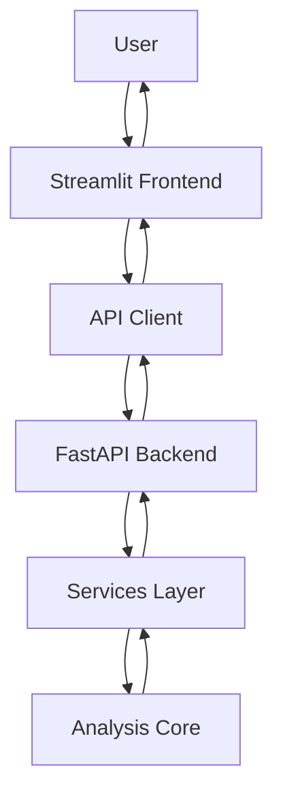

# MaBaN

**From Product Associations to Business Insights.**


MaBaN is a Market Basket Analysis application designed to uncover relationships between products in transactional data using frequent itemset mining and association rule learning.

The project combines a Python-based analytical core, a FastAPI backend, and a Streamlit frontend to make market basket analysis accessible through an interactive interface.

## Features

- **Transactional Data Analysis** — Import transaction data from CSV files.
- **Frequent Itemset Mining** — Discover frequently co-occurring items using supported algorithms.
- **Association Rule Mining** — Identify relationships between products using association rules.
- **Configurable Analysis** — Customize analysis parameters to explore different patterns in the data.
- **Interactive Interface** — Upload datasets, configure analyses, and explore results through a Streamlit frontend.
- **REST API** — Access analytical functionality through a FastAPI backend.
- **Containerized Deployment** — Run the application using Docker Compose.

*Feature availability and configuration options depend on the current implementation.*

## Architecture

MaBaN separates the user interface, API layer, business logic, and analytical core.



### Components

- **Frontend:** Streamlit interface for interacting with the application.
- **Backend:** FastAPI application exposing analytical functionality through HTTP endpoints.
- **Services:** Coordinate application logic and analytical operations.
- **Core:** Implements the algorithms and data-processing logic.

This separation helps keep the analytical functionality independent of the user interface.

## Tech Stack

| Component | Technology |
|---|---|
| Language | Python |
| Backend | FastAPI |
| Frontend | Streamlit |
| Data Processing | pandas, NumPy |
| Testing | pytest |
| Containerization | Docker, Docker Compose |

*Verify the dependencies against the project's current configuration files.*

## Getting Started

### Prerequisites

- Git
- Docker and Docker Compose

For manual installation, Python and the project's required dependencies are also needed.

### Installation

Clone the repository:

```bash
git clone https://github.com/andreasdarsa/MaBaN.git
cd MaBaN
```

### Run with Docker Compose

Build and start the application:

```bash
docker compose up --build
```

Once the services have started, open the frontend and backend using the addresses configured in the Docker Compose configuration.

**Note:** The required ports and service configuration depend on the repository's current Docker Compose setup.

### Manual Installation

For instructions on running the backend and frontend separately, refer to their respective dependency files and startup configuration.

## Usage

The typical workflow consists of the following steps:

1. Upload a transactional dataset in CSV format.
2. Configure the analysis parameters.
3. Select a supported mining algorithm.
4. Execute the analysis.
5. Explore the resulting frequent itemsets and association rules.
6. Interpret the discovered relationships between products.

### Understanding Association Rules

Association rules describe relationships between items in transactional data.

Common evaluation metrics include:

- **Support:** The proportion of transactions containing the relevant itemset.
- **Confidence:** The proportion of transactions containing the antecedent that also contain the consequent.
- **Lift:** How frequently the antecedent and consequent occur together relative to what would be expected if they were independent.

These metrics help identify potentially useful product associations. They do not, by themselves, establish causation or guarantee business outcomes.

## API

MaBaN uses FastAPI to expose backend functionality through a REST API.

The API provides an interface between the frontend and the analytical components.

When the backend is running, consult its interactive API documentation at the configured `/docs` endpoint, if enabled.

For available endpoints, request schemas, and response formats, refer to the API implementation.

## Project Structure

The project is organized around a frontend, a backend, and the analytical components.

The exact directory structure and module responsibilities should be documented here based on the current repository layout.

## Testing

MaBaN uses pytest for automated testing.

Run the test suite from the project root using the command configured for the repository.

Tests should cover the correctness of the analytical algorithms and the behavior of the relevant application components.

## Roadmap

Potential areas of future development include:

- Enhanced analytical visualizations.
- Expanded reporting and data-export capabilities.
- Additional analytical features.
- An AI-powered assistant for explaining analytical results and helping users explore potential business insights.

Planned features are subject to change as the project evolves.

## License

The project's license will be specified here once the distribution and usage terms have been finalized.
